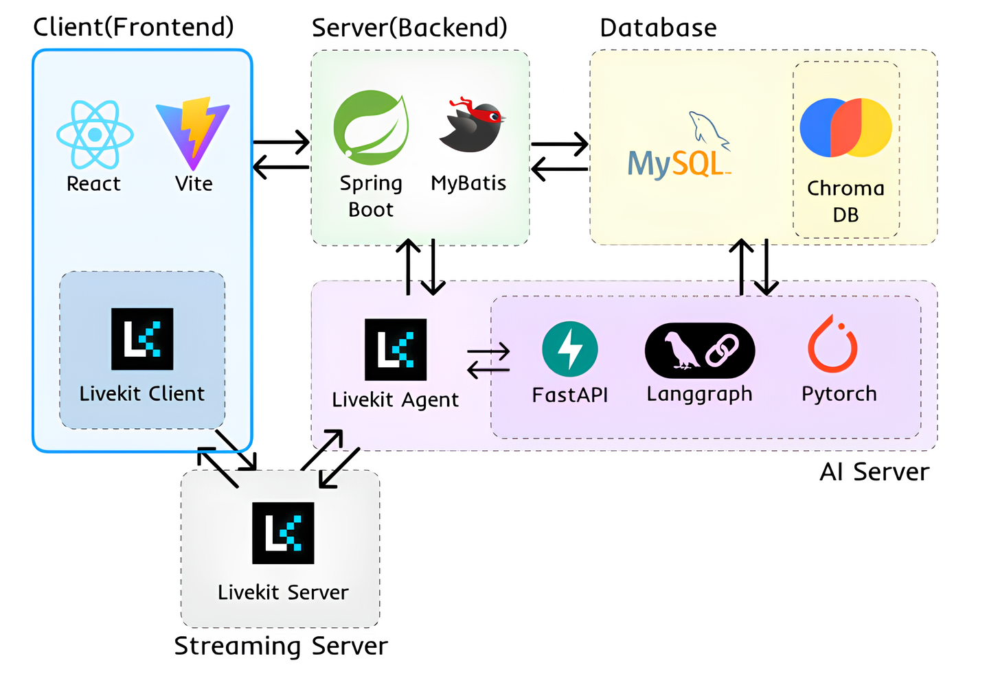
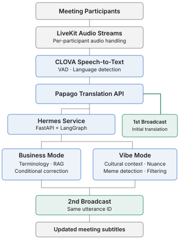
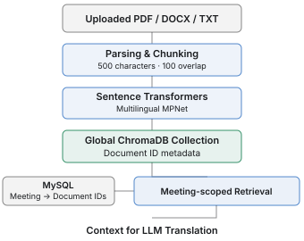

# Talaria AI — Context-Aware Meeting Translation

[한국어 문서 (Korean)](README.ko.md)

Talaria is a real-time multilingual video meeting platform that combines speech recognition, contextual translation and automated meeting analysis. This repository contains its Python AI service and real-time processing agent.

## My Role & Contributions

**Team Lead / Primary AI Developer | September–December 2025**

I led a three-member development team and was responsible for the design and majority of the implementation of the AI service. The frontend and Java backend were primarily developed by my teammates.

My contributions included the real-time translation pipeline, FastAPI service integration, LangGraph workflows, document indexing and retrieval, cultural expression analysis, and automated meeting reporting. I also proposed a reusable document architecture during an early design review to avoid repeated document processing across meetings.

## Key Features

- **Real-time translation:** Delivers initial machine translations followed by context-aware updates.
- **Business mode:** Uses technical terminology, recent conversation history and meeting-specific documents to refine translations when necessary.
- **Vibe mode:** Interprets cultural expressions, slang and emotional nuance, with contextual explanations and inappropriate-language filtering.
- **Document processing:** Supports document-grounded retrieval and translated-document reuse.
- **Meeting analysis:** Extracts summaries, decisions and action items from transcripts and produces a structured risk and improvement report.

## System Architecture



The AI service consists of two main components:

- `livekit_agent/` handles participant audio streams, speech recognition, translation requests and real-time result delivery.
- `hermes_service/` exposes FastAPI endpoints and coordinates AI workflows, document processing and meeting analysis.

The services integrate with the separate React frontend, Spring Boot backend, LiveKit server, MySQL and ChromaDB.

## Real-Time Translation Pipeline



With machine translation enabled, the agent processes participant speech using CLOVA STT and Papago, broadcasts the initial result, and sends the utterance to Hermes for contextual processing. The updated result is broadcast with the same utterance ID, allowing the client to update the corresponding subtitle.

This two-stage design separates initial response delivery from more expensive contextual refinement. Asynchronous processing also allows translation requests for multiple target languages to run concurrently.

In business mode, the LangGraph workflow checks for technical terms, relevant document context and short, context-dependent utterances before deciding whether LLM refinement is needed. An Aho–Corasick automaton supports terminology matching. When correction is unnecessary, the initial translation is retained to avoid an additional LLM call.

Vibe mode uses a separate workflow combining model-based cultural expression detection, dictionary and vector retrieval, and LLM-based translation.

## Document-Grounded RAG



Rather than creating a separate vector index for every meeting, the system stores document chunks in a shared ChromaDB collection with document IDs.

1. Parse uploaded PDF, DOCX or TXT documents and split their text into overlapping chunks.
2. Generate multilingual embeddings using Sentence Transformers.
3. Store the chunks and their document metadata in ChromaDB.
4. Retrieve the document IDs associated with the current meeting from MySQL.
5. Restrict semantic retrieval to those documents and provide relevant context to the translation workflow.

This design allows indexed documents to be reused across meetings without repeating chunking and embedding solely because a document is associated with another meeting.

## Automated Meeting Analysis

A separate LangGraph workflow processes meeting transcripts through three analytical tracks:

| Track | Output |
| --- | --- |
| Summary | Overview, keywords and decisions |
| Action items | Tasks, owners, deadlines and priorities |
| Risk analysis | LLM-based content assessment and heuristic process assessment |

Validation and bounded retry branches check the summary and action-item outputs. The results are consolidated into a structured report, translated for participant locales and stored in MySQL.

## Tech Stack

| Component | Technologies |
| --- | --- |
| AI service | Python, FastAPI, Pydantic |
| Workflow orchestration | LangGraph, LangChain, OpenAI API |
| Real-time processing | LiveKit, asyncio, CLOVA STT, Silero VAD, Papago |
| Retrieval and models | ChromaDB, Sentence Transformers, PyTorch, ELECTRA |
| Persistence | MySQL |

## Getting Started

The original development entry points are:

```bash
python -m venv .venv
source .venv/bin/activate
pip install -r requirements.txt

# Hermes API
python -m uvicorn talaria.hermes_service.main:app --app-dir src --port 8000 --env-file .env

# LiveKit agent (separate terminal)
python -m src.talaria.livekit_agent.agent dev
```

A complete environment requires OpenAI, CLOVA, Papago and LiveKit credentials, the project database and companion services, and local model and terminology assets. Configuration is supplied through environment variables. See the [original Korean documentation](README.ko.md) for historical setup notes.

## Project Status

Developed as a three-person team project in 2025. This repository preserves the original AI service implementation for portfolio and reference purposes. Some model weights, generated indexes and local assets are not included, and the current runtime environment has not been revalidated. The repository is not a standalone deployment of the complete Talaria platform.
